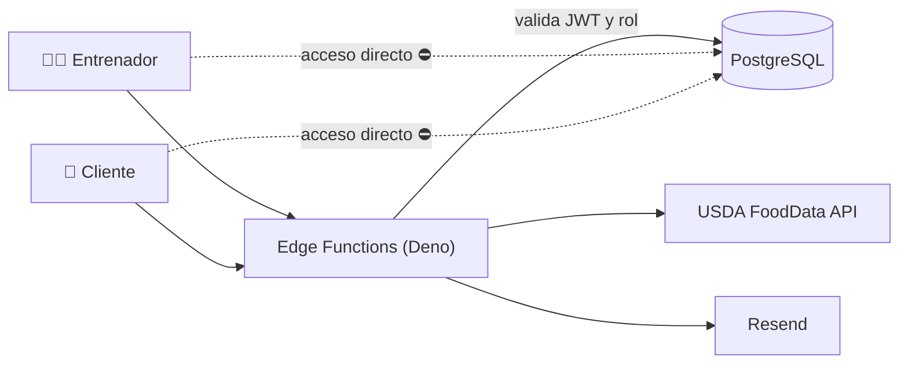

# 🏋️ Leyva Fitness — Plataforma para entrenador personal

**Portal dual entrenador/cliente con autenticación independiente, seguridad "deny-all" y cálculo automático de macros.**
 
*Dual trainer/client portal with independent auth, deny-all security and automatic macro calculation.*

<!-- 📸 Agrega aquí una captura del editor de rutinas (guárdala en /docs):

-->

---

## 📌 El problema · The problem

Un entrenador personal necesitaba entregar rutinas y planes de alimentación a sus clientes en un solo lugar, sin exponer los datos de un cliente a otro.

> *A personal trainer needed one place to deliver workouts and meal plans without exposing one client's data to another.*

## ✨ Funcionalidades · Features

- 👥 **Portal dual**: uno para el entrenador y otro para sus clientes, con **dos sistemas de autenticación JWT independientes** y contraseñas cifradas con bcrypt.
- 🏋️ **Editor de rutinas y dietas** para cada cliente.
- 🥗 **Cálculo automático de macros** con la API de USDA FoodData Central.
- ✉️ Correos transaccionales con Resend.

## 🔐 Arquitectura "deny-all" · Security

El navegador **no tiene acceso directo a la base de datos**. Todo pasa por Edge Functions que validan el rol antes de leer o escribir.

## 🧰 Stack

| Capa | Tecnología |
|---|---|
| Frontend | React · Vite · TypeScript |
| Backend | Supabase Edge Functions (Deno) |
| Datos | PostgreSQL (Supabase) |
| Integraciones | USDA FoodData Central API · Resend |
| Seguridad | JWT independientes por rol · bcrypt · deny-all |

## 📸 Capturas · Screenshots

<!-- Agrega capturas en /docs y descomenta:
| Portal entrenador | Portal cliente | Macros |
|---|---|---|
|  |  |  |
-->

## 🔒 Código · Source code

El código es **privado por acuerdo con el cliente**. Puedo mostrar una demostración en vivo en entrevista.
 *Source code is private under client agreement — live walkthrough available on request.*

---

Desarrollado por **[Alfonso Méndez](https://github.com/meyern01)** · **[Kodiak](https://getkodiak.dev)**

